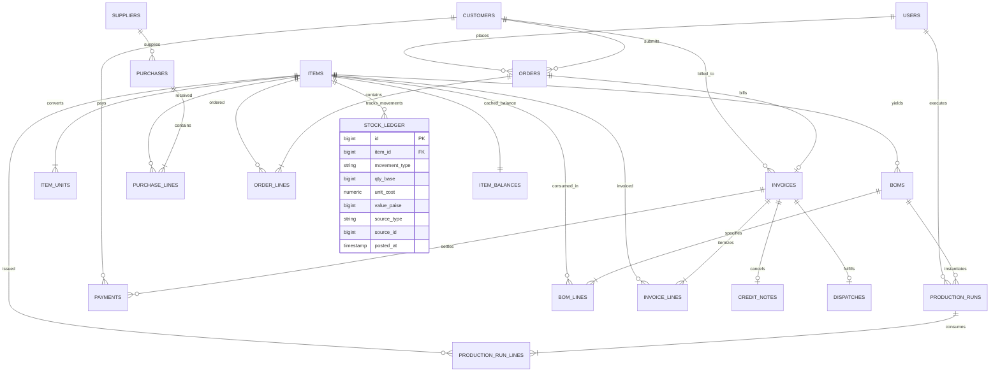
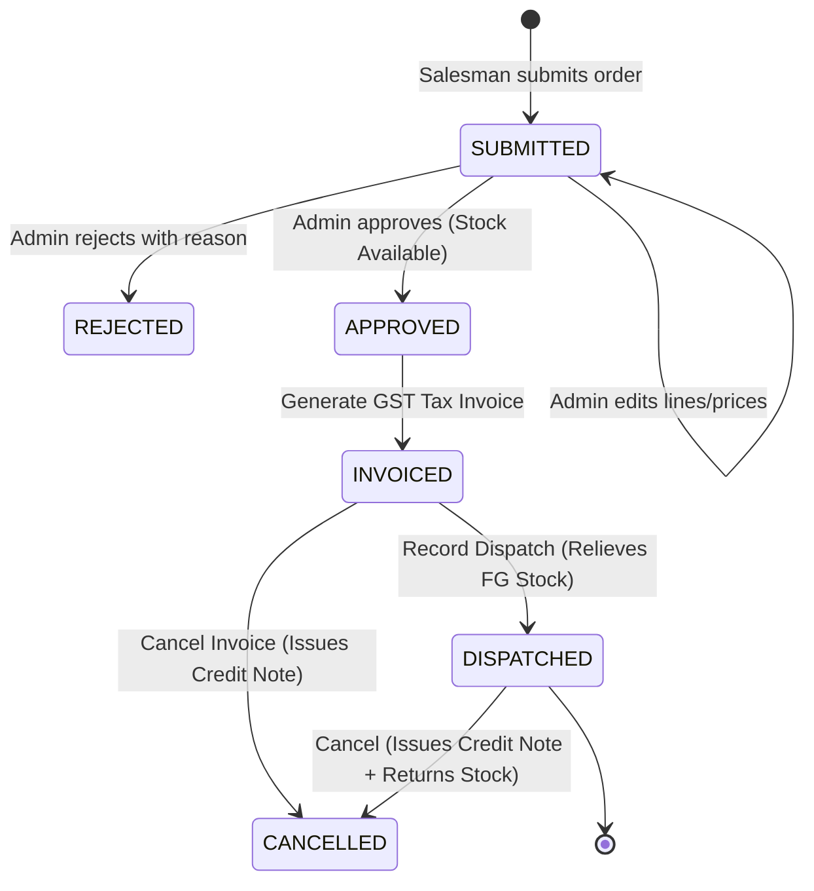

# Order-to-Audit System: Architecture & Design

## 1. Domain & Architecture Overview

The Order-to-Audit system is designed as an event-driven, ledger-backed modular monolith for South Indian snack manufacturing. At its core, the architecture enforces two immutable physical rules:
1. **Never use floating point numbers** for financial currency or inventory quantities. All money is stored as integer paise (1 INR = 100 paise, `BIGINT`). Unit costs use `NUMERIC(18,6)` with half-up rounding. Stock quantities are stored as integers in base metric units (`g`, `ml`, `piece`).
2. **Never mutate stock balances directly.** Every inventory change is an immutable row appended to `stock_ledger` through the transactional posting engine (`app/posting/engine.py`). Current item balances in `item_balances` act purely as a transactional read cache and are proven reconcilable against `SUM(qty_base)`.

---

## 2. Entity-Relationship Diagram

---

## 3. Stock & BOM Computation Engine

### 3.1 Base Metric Conversions (`core/units.py`)
All inputs across purchases, production issues, orders, and sales are converted to integer base metric units upon crossing the API boundary:
- **Raw Materials**: Grams (`g`) for solids (Flour, Spices: $1\text{ kg} = 1000\text{ g}$) or Millilitres (`ml`) for liquids (Cooking Oil: $1\text{ L} = 1000\text{ ml}$).
- **Packaging & Finished Goods**: Pieces (`piece` / `packet`). Cartons convert to packets using `item_units` factor ($1\text{ carton} = 20\text{ packets}$).
- Any fractional base unit input is rejected at validation to prevent sub-unit rounding drift.

### 3.2 BOM Issue Valuation & Production Accounting
When posting a production run:
1. **Planned Consumption**: For each BOM line, $\text{Planned} = \text{BOM Qty Base} \times \text{Batch Factor}$.
2. **Actual Consumption**: Physical supervisor issues are validated against available stock. Issues post `PRODUCTION_ISSUE` rows (negative signed quantity) valued at the item's moving WAC at the time of issue.
3. **Wastage & Yield**:
   $$\text{Yield Variance (bp)} = \left(\frac{\text{Actual Good Output} - \text{Expected Output}}{\text{Expected Output}}\right) \times 10,000$$
   $$\text{Line Variance (bp)} = \left(\frac{\text{Actual Issued} - \text{Planned}}{\text{Planned}}\right) \times 10,000$$
   A line is flagged strictly when $|\text{Variance (bp)}| > \text{Tolerance (bp)}$ (default $300\text{ bp} = 3\%$).
4. **Finished Goods Receipt**: Outputs post `PRODUCTION_OUTPUT` rows into stock valued at the computed batch cost per packet.

---

## 4. Moving Weighted Average Cost (WAC) & Overheads

### 4.1 Moving WAC Formula
On every raw material or packaging purchase receipt:
$$\text{New WAC} = \frac{\text{Existing Value (paise)} + \text{Receipt Value (paise)}}{\text{Existing Qty (base)} + \text{Receipt Qty (base)}}$$
Production issues consume inventory at this moving WAC, leaving remaining stock correctly valued.

### 4.2 Run Overhead Allocation
Direct run overheads (direct labour, power/gas, consumable other overheads) are allocated 100% to good output packets produced in that run:
$$\text{Cost Per Packet (paise)} = \text{round}\left(\frac{\text{Material \& Packaging Cost} + \text{Total Overheads}}{\text{Actual Good Output Packets}}\right)$$
$$\text{Unit Margin (paise)} = \text{Selling Price (pre-tax)} - \text{Cost Per Packet}$$
Damaged packaging (e.g. 6 burst pouches) is included in the run's material cost because it was consumed during production.

---

## 5. Order & Invoice State Machine

### 5.1 Stock Reservation & Shortage Prevention
At order approval, available stock is computed as:
$$\text{Available Stock} = \text{Ledger Balance} - \text{Qty Reserved in other Approved/Invoiced Orders}$$
If $\text{Requested} > \text{Available}$, the system blocks approval and flags the line with a shortage indicator until the admin either edits the quantity down or rejects/holds the order.

### 5.2 Immutable Invoices & Credit Notes
- Posted invoices are protected by database triggers against updates or deletion.
- Sequences follow row-locked financial year numbering (`INV/<FY>/<seq>`, `CN/<FY>/<seq>`).
- Cancelling an invoice never deletes records: it generates a linked `CreditNote`, flags the invoice as `CANCELLED`, reverses GST tax liabilities, and, if already dispatched, generates a `SALES_RETURN` ledger entry returning stock.
